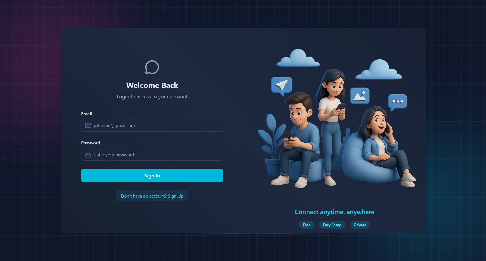
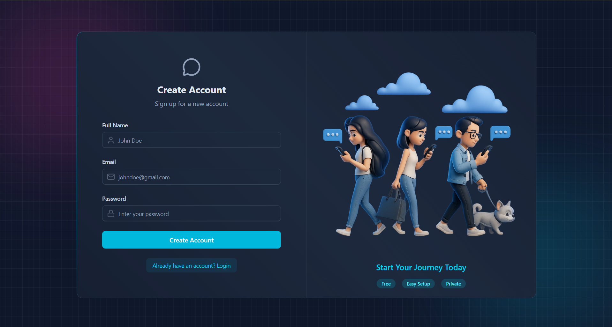
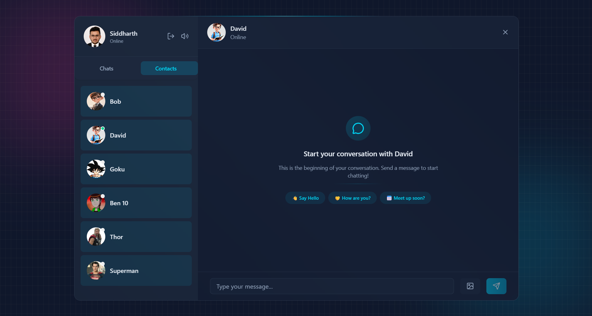
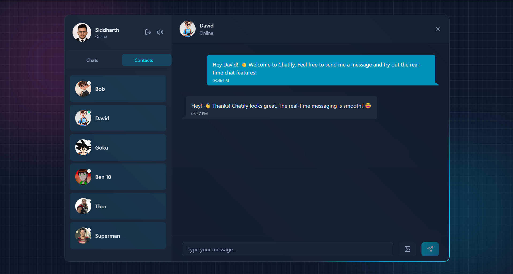
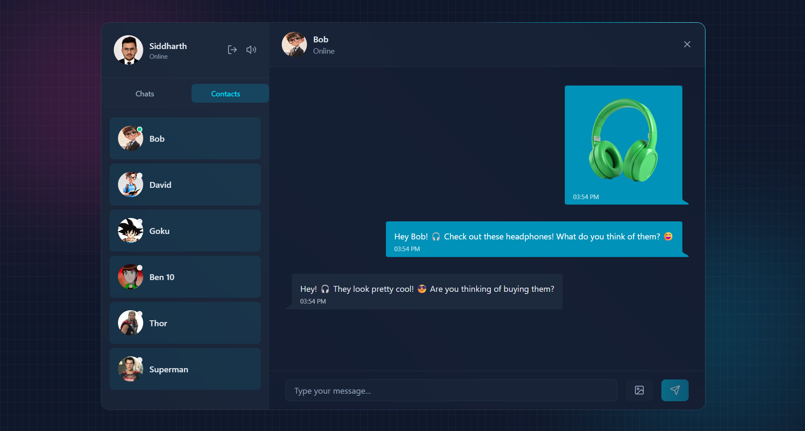

# Chatify

> **A real-time messaging application built with the MERN stack, featuring instant messaging, online presence, sound notifications, and image sharing.**

<p align="center">
  
</p>

Chatify is a full-stack real-time chat application that enables users to communicate through **instant one-to-one messaging**. It features JWT-based authentication, live online/offline status, sound notifications, and image sharing.

The application combines **React, Node.js, Express, MongoDB, Socket.IO, and Cloudinary** to deliver a responsive messaging experience with real-time communication and persistent message storage.

---

## 🚀 Features

### 🔐 Authentication & Authorization

* Custom authentication system using **JSON Web Tokens (JWT)**
* Dedicated login and signup pages
* Protected backend APIs
* Authentication and authorization middleware
* Secure access to authenticated user functionality

<p align="center">
  
</p>

<p align="center">
  
</p>

### 🟢 Online Presence

* Real-time online/offline user status
* Live presence updates through Socket.IO
* Visibility into user availability within the application

<p align="center">
  
</p>

### 💬 Real-Time Messaging

* Instant one-to-one messaging using **Socket.IO**
* Real-time message delivery without page refreshes
* Persistent message storage using **MongoDB**
* Conversation history between users
* Event-driven communication for real-time updates

<p align="center">
  
</p>

### 🖼️ Image Sharing

* Share images directly within conversations
* **Cloudinary** integration for image storage
* Image messages displayed within the chat interface

<p align="center">
  
</p>

### 🔔 Sound Notifications

* Sound notifications for incoming messages
* Toggleable sound notification settings

### 🛡️ API Security

* API rate limiting using **Arcjet**
* Protected routes and authenticated API requests
* JWT-based authentication checks
* Backend request protection against excessive requests

### ⚡ State Management

* Global state management using **Zustand**
* Centralized application state management
* Responsive UI updates during user interactions

### 📱 Responsive User Interface

* Built with **React and Tailwind CSS**
* Styled using **DaisyUI**
* Responsive layouts for different screen sizes
* Clean interface focused on the messaging experience

---

## 🏗️ Architecture

```text
                 ┌──────────────────────────┐
                 │       React App          │
                 │                          │
                 │  Login & Signup          │
                 │  Chat Interface          │
                 │  Zustand State           │
                 │  Tailwind CSS + DaisyUI  │
                 └────────────┬─────────────┘
                              │
                  ┌───────────┴───────────┐
                  │                       │
                  ▼                       ▼
          ┌──────────────┐        ┌──────────────┐
          │   REST API   │        │  Socket.IO   │
          │ HTTP Requests│        │ Real-Time    │
          └──────┬───────┘        │ Communication│
                 │                └──────┬───────┘
                 │                       │
                 ▼                       ▼
          ┌────────────────────────────────────┐
          │         Node.js + Express          │
          │             Backend               │
          │                                    │
          │  JWT Authentication & Middleware  │
          │  API Routes & Controllers         │
          └──────────────┬─────────────────────┘
                         │
             ┌───────────┴────────────┐
             │                        │
             ▼                        ▼
      ┌──────────────┐        ┌──────────────┐
      │   MongoDB    │        │  Cloudinary  │
      │              │        │              │
      │ User Data    │        │ Image Storage│
      │ Messages     │        │              │
      └──────────────┘        └──────────────┘

             ┌──────────────────────┐
             │        Arcjet        │
             │   API Rate Limiting  │
             └──────────────────────┘
```

---

## 🛠️ Tech Stack

| Category                | Technology            |
| ----------------------- | --------------------- |
| Frontend                | React.js              |
| Styling                 | Tailwind CSS, DaisyUI |
| Backend                 | Node.js, Express.js   |
| Database                | MongoDB               |
| Real-Time Communication | Socket.IO             |
| Authentication          | JSON Web Tokens (JWT) |
| Media Storage           | Cloudinary            |
| State Management        | Zustand               |
| API Security            | Arcjet                |
| API                     | REST                  |
| Version Control         | Git & GitHub          |
| Development Tools       | VS Code               |

---

## 🌐 Live Demo

Try the deployed application:

**[Chatify — Live Application](https://chatify-opal-one.vercel.app/)**

---

## ⚙️ Getting Started

### 1. Clone the repository

```bash
git clone (https://github.com/sidd-singh04/Chatify)
cd Chatify
```

### 2. Install dependencies

Install the required dependencies in the frontend and backend directories according to the project's structure.

```bash
cd frontend
npm install

cd ../backend
npm install
```


### 3. Configure the application

Set up the required environment variables and external service credentials locally, following the configuration expected by the application.

Ensure that all necessary services are configured before starting the application.

### 4. Run the Application

Start the backend and frontend in two separate terminals.

**Terminal 1: Start the Backend**

```bash
cd backend
npm run dev
```

**Terminal 2: Start the Frontend**

```bash
cd frontend
npm run dev
```

Once both servers are running, open the local URL displayed in the frontend terminal to access Chatify.

**Note:** Make sure `npm run dev` is configured in the `package.json` file of both directories. Adjust the folder names or commands if your project structure differs.

---

## 🧠 Technical Highlights

* Built a full-stack real-time messaging application using the MERN stack.
* Implemented custom authentication and authorization using JWT.
* Designed RESTful backend APIs using Node.js and Express.
* Integrated Socket.IO for instant messaging and real-time user presence.
* Implemented configurable sound notifications for incoming messages.
* Integrated Cloudinary for image uploads and media sharing.
* Used MongoDB for persistent user and message data.
* Implemented API rate limiting using Arcjet.
* Used Zustand for global application state management.
* Built a responsive user interface using React, Tailwind CSS, and DaisyUI.
* Integrated REST APIs with event-driven real-time communication.

---

## 🔐 Security & Configuration

Chatify incorporates authentication, authorization, and API protection into its backend architecture.

Security-related components include:

* **JWT:** Authentication and protected API access.
* **Authentication Middleware:** Validates access to protected backend routes.
* **Arcjet:** API rate-limiting capabilities.
* **Environment Variables:** Keeps sensitive configuration and service credentials outside the source code.
* **Cloudinary:** Handles image storage and delivery.

Sensitive credentials should never be committed to the repository. Configure the application locally using your own credentials and keep private configuration files out of version control.

---

## 🎯 Project Focus

Chatify was built to gain practical experience in developing a full-stack real-time application, covering **MERN stack development, REST API design, JWT authentication, authorization, WebSocket communication, database integration, media uploads, API security, and frontend state management**.

The project demonstrates how HTTP APIs, real-time events, persistent storage, and third-party services work together to create a responsive messaging application.

---

## 👨‍💻 Author

**Siddharth Singh**

GitHub: [@sidd-singh04](https://github.com/sidd-singh04)
